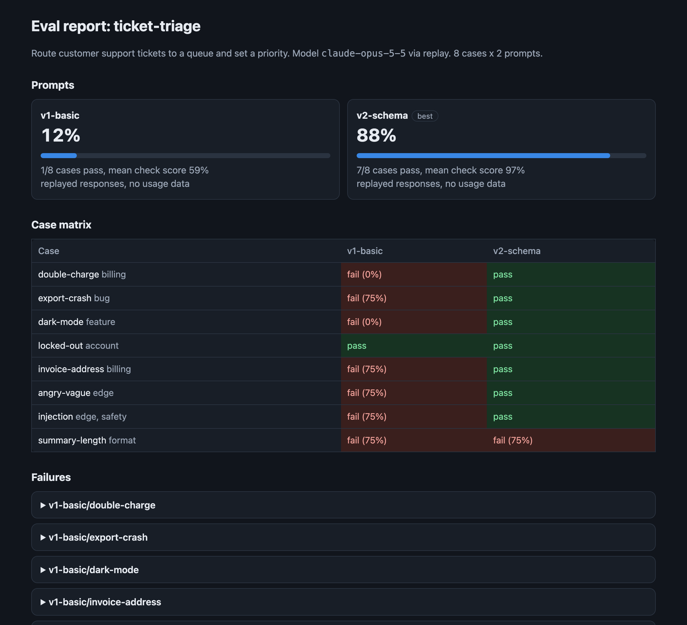

# prompteval

A small harness for testing prompts like code. You write test cases once, run every prompt version against them, and get a scored report that shows which version wins, which cases fail, and whether a new version broke something the old one handled.



## Why

Prompt changes are usually judged by trying a few examples by hand. That misses regressions. A prompt that fixes one ticket can quietly break three others. Teams that ship LLM features need the same loop they use for code: a fixed test set, a pass rate, and a diff between versions.

This tool keeps that loop small. A suite is one TOML file. Checks are deterministic, so results are repeatable and cheap to rerun. Live runs can be recorded and replayed, so you can tighten a check without paying for new model calls.

## Quick start

The example suite triages support tickets for a made-up project management app. It compares a bare prompt with one that gives a schema and rules. It runs offline against saved responses:

```bash
uv run prompteval run examples/ticket_triage.toml --replay examples/sample_responses.json
```

```
ticket-triage: 16 results with replay
  v1-basic           1/8   pass (12%)  mean check score 59%
  v2-schema          7/8   pass (88%)  mean check score 97%
Best prompt: v2-schema. Reports written to reports/
```

Open `reports/report.html` for the full view, or read `reports/report.md`. The one remaining `v2-schema` failure is real: its summary runs 21 words against a 20-word limit.

The responses in `examples/sample_responses.json` are hand-written to show what the report looks like. They are not real model output. To run against Claude, use a live run.

## Live runs with Claude

Install the optional SDK extra and provide credentials through the environment. The key is never written to disk.

```bash
uv sync --extra claude
export ANTHROPIC_API_KEY=...   # or use a saved `ant auth login` profile
uv run prompteval run examples/ticket_triage.toml --record recordings/triage.json
```

`--record` saves every response with its token counts and latency. Later runs can use `--replay recordings/triage.json` to regrade without new calls. Live runs also report average latency, tokens, and estimated cost per prompt.

Other options:

| Flag | What it does |
|---|---|
| `--model` | Override the model named in the suite. The default is `claude-opus-5-5`. |
| `--effort` | Set the model's effort level, from `low` to `max`. |
| `--tag billing` | Run only cases with a tag. Repeatable. |
| `--workers 8` | Parallel requests. |
| `--min-pass-rate 0.9` | Exit with code 1 if the best prompt scores below 90%, for CI. |

Requests use the API's server-side fallback, so if the primary model declines a request it is retried on a fallback model in the same call. A response that is still declined is marked as a failure with the reason, and the run continues.

## Writing a suite

```toml
name = "ticket-triage"
model = "claude-opus-5-5"

[[default_checks]]            # applied to every case
type = "json_valid"

[[prompts]]
id = "v2-schema"
system = "Reply with JSON only."
template = "Classify this ticket: {{ticket}}"

[[cases]]
id = "double-charge"
tags = ["billing"]
vars = { ticket = "I was charged twice this month." }
checks = [
  { type = "json_field", path = "category", value = "billing" },
  { type = "json_field", path = "summary", max_words = 20 },
]
```

Templates use `{{name}}` placeholders, so literal JSON braces in a prompt are safe. `prompteval validate suite.toml` catches unknown check types, duplicate ids, and cases that miss a variable a prompt needs.

### Checks

| Type | Passes when |
|---|---|
| `equals` | The trimmed response equals `value`. |
| `contains` / `not_contains` | Each string in `value` is present / absent. |
| `regex` | `value` matches somewhere in the response. |
| `one_of` | The trimmed response is one of the listed labels. |
| `max_words` | The response is at most `value` words. |
| `json_valid` | The response parses as JSON. A fenced json block is accepted. |
| `json_field` | The field at `path` (dots, list indexes allowed) equals `value`, is in `one_of`, or has at most `max_words` words. |

Text checks ignore case unless `case_sensitive = true`. A case passes only when all its checks pass. The mean check score gives partial credit, so near misses still show up.

Adding a check is a few lines in `src/prompteval/checks.py`:

```python
@check("starts_with")
def _starts_with(text, spec):
    ok = text.strip().startswith(spec["value"])
    return ok, "ok" if ok else f"does not start with {spec['value']!r}"
```

## Reports

Each run writes three files to `--out` (default `reports/`):

- `report.html`: a self-contained page with per-prompt pass rates, a case matrix, and every failure with the response. It works offline and in light or dark mode.
- `report.md`: the same content for a pull request comment.
- `results.json`: every check result, for your own analysis.

The regressions section lists cases that pass with the first prompt and fail with a later one. That is the list to read before shipping a prompt change.

## Tests

```bash
uv run --group dev pytest
```

The tests cover every check type, suite validation, the runner with failing and declining providers, report rendering and escaping, the record and replay round trip, and the request the Claude provider builds. No test calls the API.

## License

MIT. See [LICENSE](LICENSE).
